<div align="center">

# ⚡ 景同志·电脑加速 (JingBoost)

**一款纯本地运行的 Windows 电脑加速 / 维护工具 · 40+ 项功能 · 无广告 · 无捆绑 · 完全免费开源**

[](https://github.com/jingpanlong/JingBoost/releases)
[](#-下载)
[](#-从源码运行)
[](https://github.com/jingpanlong/JingBoost/blob/main/LICENSE)
[](#)


*界面由 WebView2 渲染，后端 Python + ctypes 直接调用 Windows API —— 不联网、不上传任何数据。*

[📥 下载最新版](https://github.com/jingpanlong/JingBoost/releases/latest) · [🚀 从源码运行](#-从源码运行) · [🛠 自行打包](#-自行打包-exe) · [💬 联系作者](#-联系作者)

</div>

---

## ✨ 它能做什么

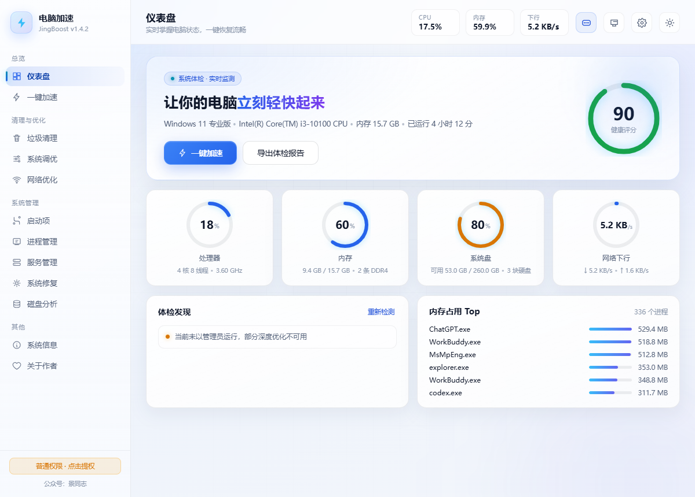

打开就是一块**实时仪表盘**：CPU / 内存 / 系统盘 / 网络四环仪表 1.6 秒刷新，右上角 **0~100 健康评分**（绿=放心 / 橙=留意 / 红=该清理了），下方直接列出体检发现的问题清单与内存占用 Top，可一键导出体检报告到桌面。

### 功能总览（40+ 项，全部可用）

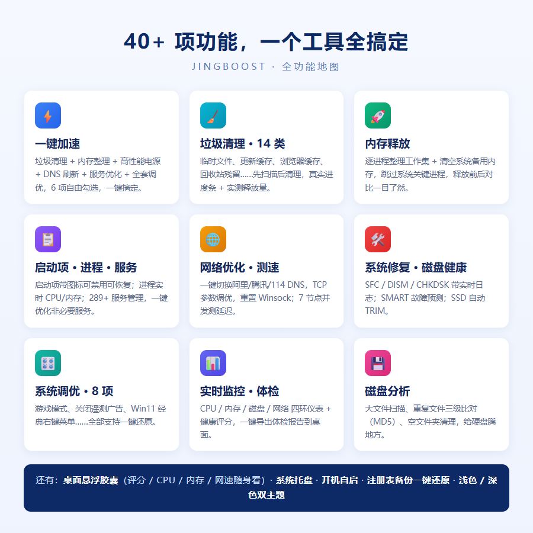

## 🧹 垃圾清理 · 14 类

进入页面**自动扫描**，先预览再清理；清理过程是带百分比的真实进度条，逐项显示当前正在处理的内容，清完的每一行立刻变成 `0 B ✓`，释放量取清理前后**实测差值**，不是估算数。

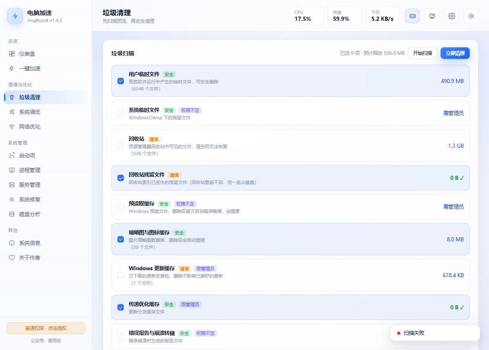

> 💡 一个能拉开差距的细节：回收站里有一类**索引丢失的孤儿文件**（`$Recycle.Bin` 下的 `$R` 数据），资源管理器看不见、系统「清空回收站」也永远删不掉，几个 GB 就这么一直占盘。本工具把这类残留单独列为清理项，专治「回收站明明是空的，硬盘空间却回不来」。

覆盖：用户 / 系统临时文件、回收站 + **回收站残留**、预读取缓存、缩略图与图标缓存、Windows 更新缓存、传递优化缓存、错误报告与崩溃转储、浏览器缓存（Edge / Chrome / Brave / 360）、系统日志与安装残留、开发工具缓存、DNS 缓存、升级残留。

## ⚡ 一键加速

垃圾清理 + 内存整理 + 高性能电源 + DNS 刷新 + 非必要服务优化 + 全套系统调优，6 个选项自由勾选，每一步结果逐步输出。

> 注意：一键加速**不包含「自动杀进程」**——不会为了凑数字把你正在使用的工作杀掉。

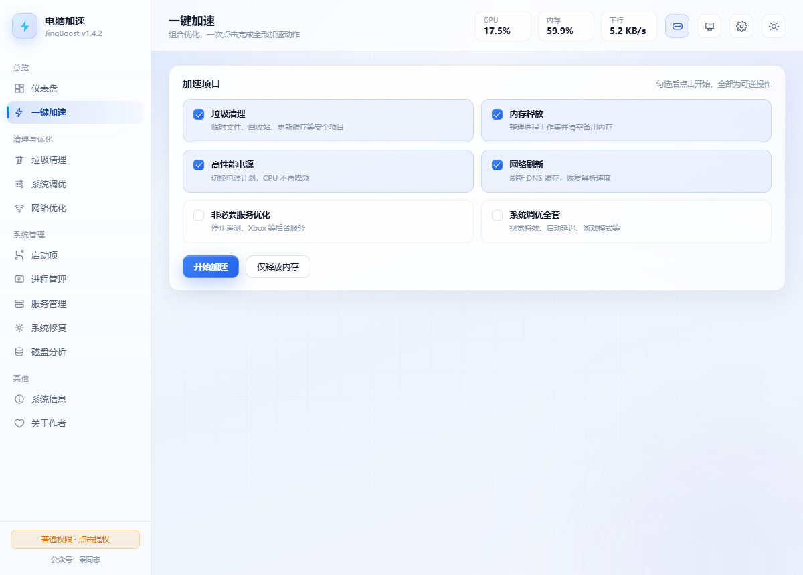

## 🎛 系统调优 · 8 项（全部可一键还原）

性能优先视觉特效 / 取消开机启动延迟 / 游戏模式 + 关闭后台录制 / 关闭遥测与广告推送 / 启用超长路径 / 关闭搜索索引 / 关闭 SysMain / 恢复 Win11 经典右键菜单。

**所有注册表改动在动手前自动记录原值**，随时一键还原，折腾坏了也不怕。

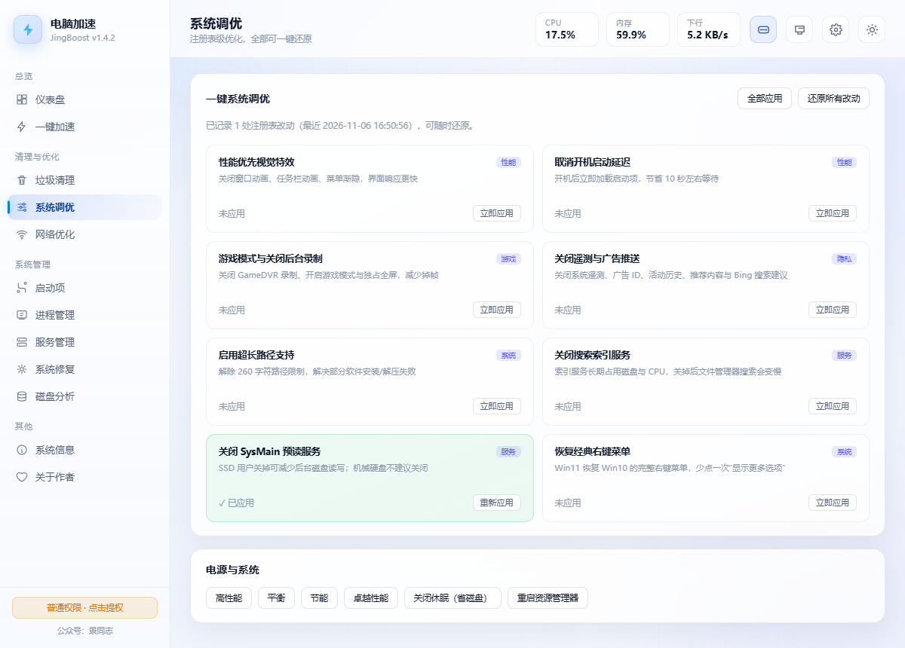

## 🌐 网络优化 + 测速

一键切换阿里 / 腾讯 / 114 DNS、恢复自动获取、刷新 DNS、TCP 全局参数调优、重置 Winsock / TCP/IP、hosts 查看 / 重置 / 恢复。内置 **7 节点并发 TCP 握手测速**（百度、腾讯、阿里 DNS、114、GitHub、Google、Google DNS），比 ICMP 更贴近真实可用性。

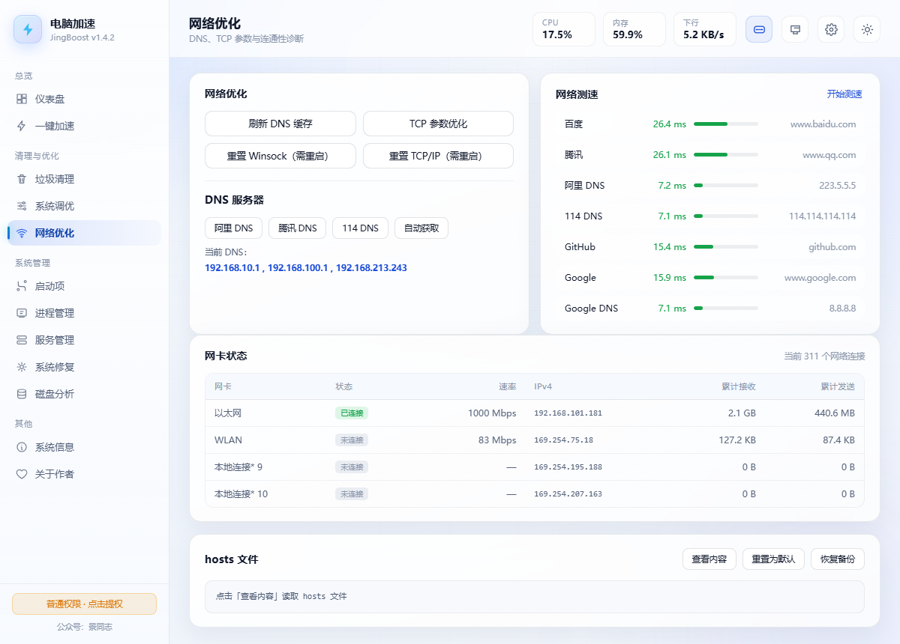

## 📋 启动项 · 进程 · 服务

- **启动项**：注册表 `Run / RunOnce`（HKCU / HKLM / WOW6432Node）+ 启动文件夹，每项带程序图标，禁用进备份区可随时恢复
- **进程**：实时 CPU / 内存占用、结束进程、调整优先级，系统关键进程白名单保护
- **服务**：289+ 服务状态与启动类型管理，一键优化遥测、Xbox、传真等非必要服务

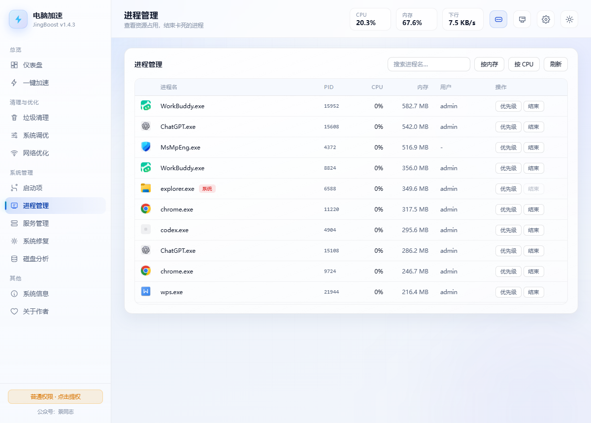

## 🛠 系统修复 · 磁盘健康 · 磁盘分析

- **修复**：SFC / DISM / CHKDSK 全部带实时日志；磁盘优化自动识别 SSD 走 TRIM、机械盘走碎片整理；一键创建系统还原点
- **磁盘健康**：SMART 故障预测、介质类型、还原点列表——硬盘快坏了提前知道
- **磁盘分析**：大文件扫描（50MB~1GB 阈值）、重复文件三级比对（大小 → 头部 MD5 → 全量 MD5）、空文件夹扫描

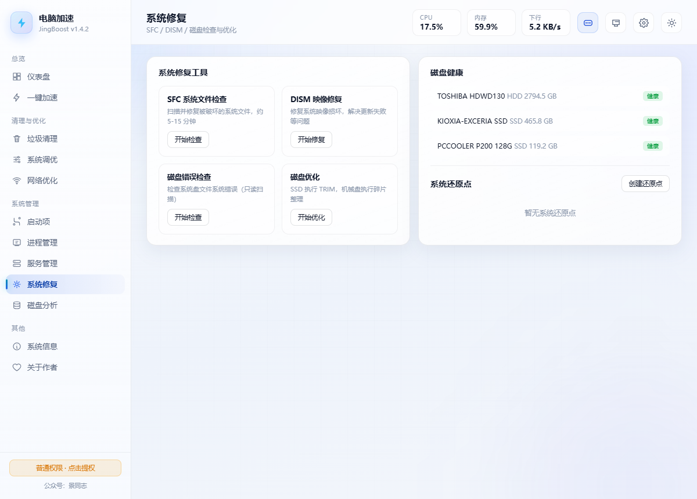

## ℹ️ 系统信息

CIM/WMI → SMBIOS 注册表 → psutil/ctypes **三层兜底采集**，自动过滤 `To Be Filled By O.E.M.` 占位值，组装机也能给出可读结果：系统与激活状态、主板 BIOS、CPU / 内存 / 显卡 / 网卡 / 磁盘一页列清。

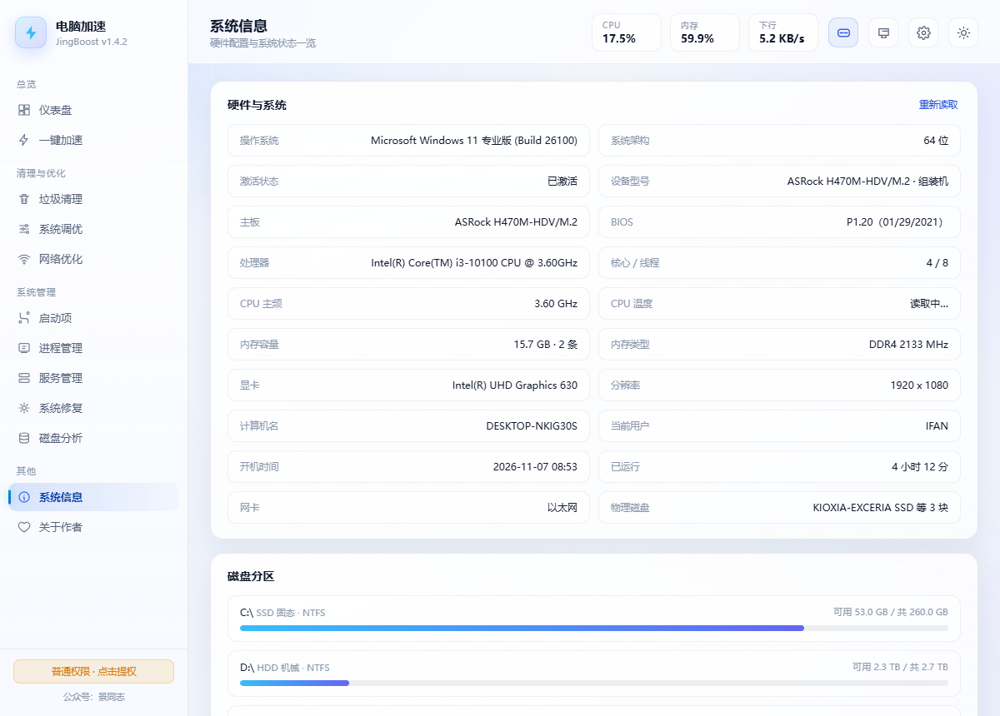

## 🌙 深色模式 + 桌面悬浮胶囊

浅色 / 深色双主题一键切换、记住选择；**桌面悬浮胶囊**常驻桌面：健康评分 / CPU / 内存 / 网速随身看，可拖动、贴边自动隐藏、原地一键加速（带涟漪 + 扫光特效），透明度 / 7 套配色 / 显示内容均可自定义。

<div align="center">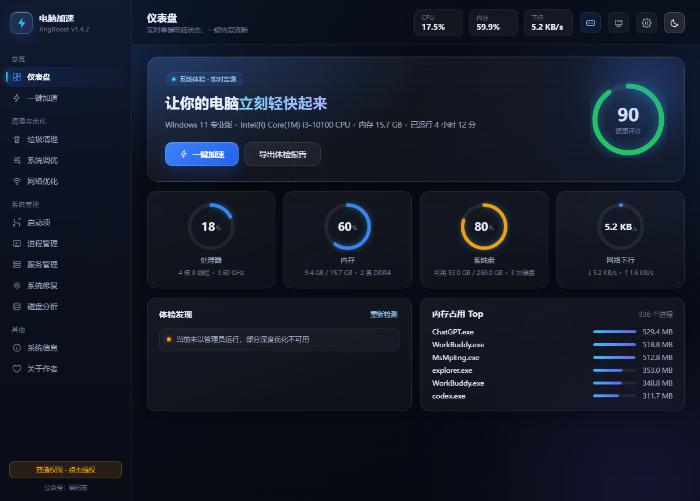 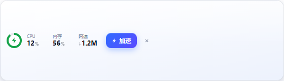</div>

## 🔒 安全设计（为什么敢放心用）

- 🔒 **不联网**：所有操作均为本地读写，不上传任何数据
- 🔒 **可还原**：所有注册表改动写前备份，一键还原全部改动
- 🔒 **有保护**：csrss / winlogon / lsass 等系统关键进程白名单，不误杀
- 🔒 **先预览**：清理前先扫描，危险项默认不勾选；无权限目录明确标注「需管理员」而不是假装 0 B
- 🔒 **不越界**：一键加速不含自动杀进程，不碰你正在干活的程序

## 📥 下载

前往 [**Releases**](https://github.com/jingpanlong/JingBoost/releases/latest) 页面，两种版本任选：

| 文件 | 说明 |
| --- | --- |
| `景同志电脑加速.exe` | **绿色版**：单文件，下载双击即用，不写注册表 |
| `景同志电脑加速_安装版.exe` | **安装版**：图形化安装向导，可选目录、创建快捷方式、支持卸载 |

> 运行环境：Windows 10 / 11，需要 WebView2 运行时（Win11 与新版 Win10 已内置）。安装版默认装到 `%LOCALAPPDATA%\Programs\JingBoost`，无需管理员权限。

## 🚀 从源码运行

```bash
git clone https://github.com/jingpanlong/JingBoost.git
cd JingBoost
pip install pywebview psutil pythonnet
python src/main.py
```

**目录结构**

```
JingBoost/
├── src/
│   ├── main.py          程序入口（主窗口 + 胶囊 + 托盘 + 单实例交接）
│   ├── api.py           前后端桥接：50+ 接口 + 异步任务系统
│   ├── ui.py            托盘 / 胶囊 / 主窗口协同控制器
│   ├── core/            功能实现（ctypes 直调 Win32 API）
│   │   ├── cleaner.py       14 类垃圾清理（含回收站孤儿残留）
│   │   ├── winapi.py        ctypes：提权 / 内存 / 回收站
│   │   ├── reg.py           注册表读写与改动备份/还原
│   │   ├── network.py       网络诊断与优化
│   │   ├── sysinfo.py       硬件信息与实时监控
│   │   └── ...
│   └── web/             界面（HTML + CSS + JS，无框架）
│       ├── index.html   主界面
│       └── widget.html  桌面悬浮胶囊
├── installer/           图形化安装向导
├── build/               打包脚本
└── docs/images/         截图
```

## 🛠 自行打包 exe

```bash
pip install pyinstaller
python build/build_all.py
```

产物：`dist/景同志电脑加速.exe`（单文件绿色版）+ `dist/景同志电脑加速_安装版.exe`（安装向导）。

## 📄 本地数据存放位置

| 内容 | 路径 |
| --- | --- |
| 界面设置（主题、托盘/胶囊开关） | `%APPDATA%\JingBoost\settings.json` |
| 注册表改动备份、禁用的启动项 | `%APPDATA%\JingBoost\backups\` |
| 崩溃日志 | `%LOCALAPPDATA%\JingBoost\logs` |

## 📜 更新日志（摘要）

| 版本 | 主要变化 |
| --- | --- |
| v1.4.3 | 关于页新增 GitHub 开源地址与最新版下载入口 |
| v1.4.2 | 单实例锁改用会话内命名空间 + 僵尸锁自愈；排除 `_MEI*` 解包目录；崩溃日志迁移 |
| v1.4.1 | 清理实测释放量就地扣减、百分比进度条、进页自动扫描等 4 处体验修复 |
| v1.4.0 | 回收站口径重做 + 新增「回收站残留文件」清理；悬浮胶囊自定义（透明度 / 配色 / 显示项） |
| v1.3.0 | 仪表盘数据修正；CPU 温度 / 网速上下行；提权交接时序重做 |
| v1.1.x | 系统托盘、开机自启、悬浮胶囊、深浅双主题 |
| v1.0.0 | 40+ 项功能首发 |

完整变更见 [README_DEV.md](README_DEV.md)。

## 💬 联系作者

- 微信公众号：**景同志**
- 小红书：**景同学**
- 使用问题 / 功能建议：欢迎提 [Issue](https://github.com/jingpanlong/JingBoost/issues)

<div align="center">

**如果这个工具帮到了你，点个 ⭐ Star 就是最好的支持！**

</div>

## 📃 License

[MIT](https://github.com/jingpanlong/JingBoost/blob/main/LICENSE) © 景同志
